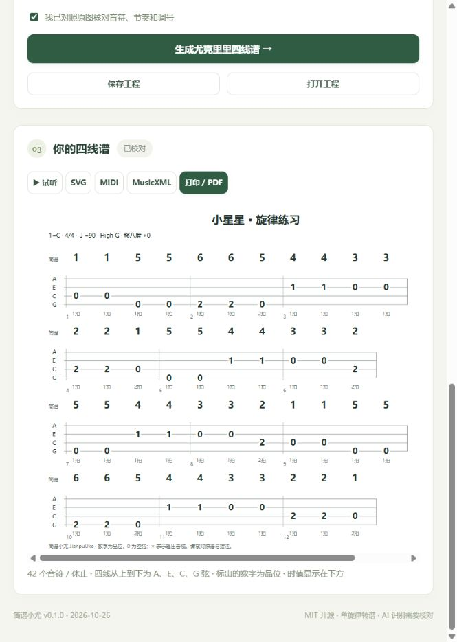

# 简谱小尤 · JianpuUke

**将简谱图片转录成可校对的音符，再生成尤克里里四线弹奏谱。**

版本 **0.2.0** · 构建日期 **2026-10-26** · MIT 开源
项目地址：https://github.com/xhnwill/youkelili

现已提供在线网页版和 Windows 本机版。图片识别使用你配置的联网视觉模型；音符解析、指法计算、试听、导出在浏览器或本机完成。软件不自带 AI 账号或额度，不含本地 OCR 模型。

**在线使用：[youkelili.xiao-dev.top](https://youkelili.xiao-dev.top)**

网页版无需安装，手机和电脑浏览器均可打开。点击“识谱接口”填写完整 HTTPS 地址、支持图片的模型名和自己的密钥，再上传图片识别。图片选区与密钥经网站临时转发到你配置的服务商，不保存到网站数据库；仍需对照原谱校对。

网页代码与 Cloudflare 部署配置在 [website/](website/README.md)，部署与验证说明见 [网页版部署](docs/WEB_DEPLOYMENT.md)。本次部署到用户指定的 Cloudflare 账户，GitHub 用于源码管理，未部署到 GitHub Pages 或 Sites。此前提供的 Windows 便携包仍为 v0.1.0；本次交付重点为在线 v0.2.0。

## 使用

**Windows 成品版：** 下载成品压缩包，解压后双击 **JianpuUke.exe**。软件会打开本机浏览器工作台，无需安装 Python。使用完点击右上角“退出”；关闭网页本身不会退出本机服务。

**源码版：** 安装 Python 3.9 或更新版本，双击 **启动.cmd**。首次启动会在项目内创建 .venv 并联网安装 Pillow。也可手动执行：

    python -m venv .venv
    .venv\Scripts\python -m pip install -r requirements.txt
    .venv\Scripts\python app.py

### 图片到四线谱

1. 打开“识谱接口”，填写完整接口地址、支持图片的模型名和 API Key。接口须兼容 Chat Completions；详细配置见 [接口说明](docs/AI_INTERFACE.md)。
2. 选择或拖入 PNG、JPEG、WebP 简谱图片。建议先框选一行或一段，保留高低音点和减时线，排除标题与歌词。多行可分次识别并勾选“追加”。
3. 点击“AI 识别简谱”。识别结果进入校对区，无法确认的内容会单独提示；AI 不确定调号时，需要手动设置“1=”。
4. 对照原图校对音符、节奏和调号。选择普通 **High G** 或低音弦 **Low G**，按实际琴弦设置。
5. 点击“生成尤克里里四线谱”。上方是简谱，下方是 A/E/C/G 四根弦的品位，底部标注每音的拍数。
6. 可以先试听，再标记已校对并导出 SVG、MIDI、MusicXML，或通过“打印 / PDF”另存 PDF。超出音域的音用 **×** 标出，需要手动移八度或改编后导出。

“试试示例”加载《小星星》图片和预置音符，用于体验转谱、试听与导出，**不会调用 AI，也不能作为识谱准确率证据**。

## 输入格式

| 写法 | 含义 |
| --- | --- |
| 1 2 3 4 5 6 7 | 音阶，以 1= 指定根音；未标八度的 1 以 C4 所在八度为基准 |
| 0 | 休止一拍 |
| 1' / 1, | 升高 / 降低一个八度，最多三个八度标记 |
| #4 / b7 | 临时升降音；只影响当前音 |
| 1/2 / 1/4 / 1/8 | 半拍 / 四分之一拍 / 八分之一拍（减时线） |
| 1. / 1/2. | 一拍半 / 四分之三拍 |
| 1 - 或 1*2 | 两拍；每个延音线增加一拍 |
| 竖线 | 小节分隔；未写竖线时按拍号自动分组 |
| ; 注释 | 分号后至行尾为注释 |

示例：

    1 1 5 5 | 6 6 5 - | 4 4 3 3 | 2 2 1 -
    1' 7 6/2 5/2 4 | #4 b7 0 1

## 当前范围与限制

- 面向**单旋律简谱**，不能自动补写和弦伴奏或完整指弹编曲。
- AI 可能漏看音点、减时线、连音、临时升降号；每张图片都需要校对。本版本未基于用户真实谱图做准确率评估。
- 暂不支持和弦、多声部、反复、倚音、滑音和三连音。可先人工展开成支持的单旋律。
- 指法采用全句动态规划，优先低把位、小幅移动；不代表专业演奏者的唯一或最优指法。
- 1= 根音按大调音阶的级数映射；小调简谱请保留其实际 1= 调号和以 6 为主音的写法。
- 明确设置移八度时才改变实际音高；超出琴的音域不会被悄悄删除或移调。
- 当前直接导入**图片**。PDF 请先将需要的页面截图或转成 PNG；不把普通 OCR 当作简谱识别器。
- 试听为合成音色，用于核对旋律和节奏，非真实尤克里里采样。
- 打印采用浏览器排版；长谱建议导出 MusicXML 后在 MuseScore 中进一步分页。

## 数据处理

- 本机服务仅监听 127.0.0.1，默认随机端口。
- 点击 AI 识别才向配置的接口发送当前选区；服务商可能收取费用并按其政策处理图片。
- API Key、接口设置仅保留在页面内存，刷新需重填，不写入日志、工程文件或 Git。
- 用户主动保存的工程包括谱面设置、音符和原图片，便于继续编辑；不要把私人谱图工程提交到公开仓库。

## 开发与构建

    python -m unittest discover -s tests -v
    powershell -ExecutionPolicy Bypass -File scripts/build.ps1

构建需要 PyInstaller，产物是 dist/JianpuUke.exe。CI 在 push/PR 时跑测试；手动运行 workflow 可构建 Windows 成品。

目录职责：

| 路径 | 职责 |
| --- | --- |
| app.py | 本机 HTTP 服务与启动入口 |
| uke/ | 简谱解析、指法计算、AI 接口、乐谱导出 |
| web/ | 无框架中文工作台、图片裁剪、试听和打印 |
| tests/ | 音高、节奏、指法与模拟视觉接口回归测试 |
| scripts/ | 示例素材生成和 Windows 打包 |
| docs/ | 使用、架构、接口、版本日志与验证边界 |
| .github/ | 自动测试与手动构建 |
| third_party/ | 随成品分发的运行时和图像处理依赖许可 |
| website/ | 独立网页版、浏览器音乐核心、Cloudflare Worker 和部署配置 |

详见 [设计说明](docs/ARCHITECTURE.md)、[项目日志](docs/LOGBOOK.md)、[验证记录](docs/VALIDATION.md)。依赖与许可见 [第三方说明](docs/THIRD_PARTY.md)。
