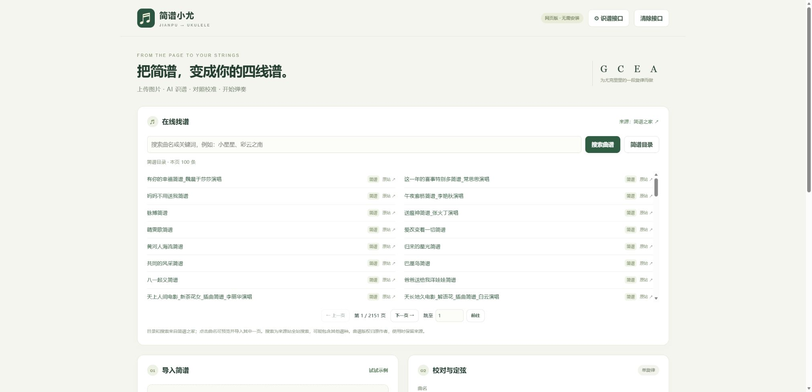

# 简谱之家列表与搜索

v0.3.0 · 2026-10-26

## 使用

网页版顶部“在线找谱”默认显示用户指定的 https://www.jianpujia.com/list/2702-0.html 简谱目录。支持上一页、下一页和跳页。

输入曲名或关键词会调用来源站的公开全站搜索，结果保留谱种标签，可能包括吉他谱、钢琴谱等其他谱种；点击“简谱目录”可回到简谱分类。

点击曲名打开预览；多张乐谱可逐张查看。点击“导入这页简谱”会将当前图片作为转谱输入，GIF 也会在浏览器中转为 PNG。导入后仍需框选、点击 AI 识别、校对并生成四线谱，不会自动调用收费模型。

每项保留原站链接与来源标识。曲谱版权归原作者，不把全站图片打包进开源项目，不批量抓取图片。

## 实现

- website/lib/catalog.mjs：固定来源站列表、搜索表单、详情解析和按需图片读取。
- GET /api/catalog?mode=list&page=0：来源站目录；页码从 0 开始。
- GET /api/catalog?mode=search&q=关键词&page=0：来源站搜索；后续页带返回的 searchId。
- GET /api/catalog/detail?path=/jianpu/数字.html：提取正文中的图片页。
- GET /api/catalog/image?path=乐谱路径&index=0：只读取详情中对应的那一张图片，不接受任意 URL。
- website/public/catalog.js：列表、分页、预览与导入交互。

列表、搜索、详情只提取所需数据，不执行来源站脚本。抓取页面和重定向限制在固定来源；图片限制在来源站图片域名及 PNG/JPEG/GIF/WebP，最多 12 MB。相同元数据在 Worker 实例内最多缓存 5 分钟，图片可由浏览器缓存 30 分钟；没有建立全站曲谱数据库。

来源站超时、拒绝访问、搜索 ID 失效或结构变化时，界面显示错误并提供原站入口，不用静态假结果替代。

## 验证边界

解析测试覆盖主列表范围、真实搜索表单与分页结构、实体解码、侧栏排除、多图、来源限制和图片 MIME。实际来源站页面用于验证目录、搜索、详情解析；公网接口与导入流程的验收结果记录在项目日志。

本功能不改变 AI 识谱的验证边界：没有配置真实模型密钥时，只能证明找谱、预览和导入链路，不能证明自动转录准确率。

本地 Edge 的目录、搜索翻页、预览和导入已实际操作验证；公网接口返回真实结果。公网浏览器自动化导航超时，未完成公网视觉复核。下面为本地界面截图：

